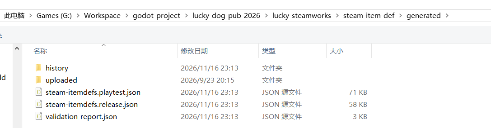
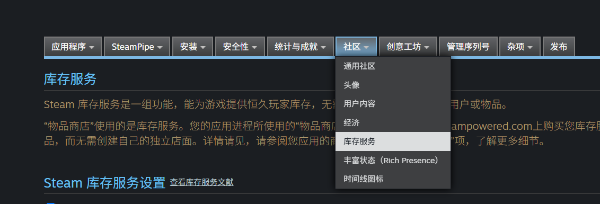
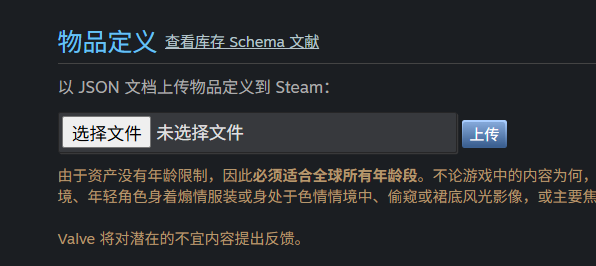

# Steam ItemDef 转换器与上传流程

`build-steam-item-defs.js` 合并 Luban 生成的 Steam 平台规则、实际物品、盲盒概率和投放计划，转换为 Steam Inventory schema，并校验 LinkTree 回执、盲盒奖励池与直接奖励 PlaytimeGenerator 投放关系。

本文件是主人日常维护 Steam 物品定义的操作入口。下面的 SOP 按当前转换器按钮及 2026-11-16 的 Steam 后台界面整理；后文保留转换命令和详细校验规则。

## 日常操作流程（SOP）

1. **更新配表并导出 Luban。** 实际物品维护在 `Item` 表；回执、Bundle、Generator 等平台规则维护在 `SteamItemDef` 及相关业务表。导出到 `lucky-dog-rise/Data/Json/` 后再运行转换器。分配 ID 以 [SteamItemDefIdRange 导出数据](../../lucky-dog-rise/Data/Json/tbsteamitemdefidrange.json)为准。

2. **先在转换器里本地预览。** 双击本目录的 [Start-SteamItemDefTool.cmd](Start-SteamItemDefTool.cmd)，在网页选择 `playtest` 或 `release`，核对显示的 AppID，然后点击“重新读取”。在“定义预览”逐条查看本次新增、修改的物品及右侧 JSON；确认“校验结果”为 **0 个错误**，并查看“上传对照”的预计修改条数。警告需逐条确认原因；有错误时先处理，不能上传目录中残留的旧 JSON。

3. **生成上传文件。** 点击“生成文件”，再点击“打开输出目录”。网页会同时生成两个渠道的文件；切换预览标签不代表只生成该渠道。输出目录为：

   ```text
   G:\Workspace\godot-project\lucky-dog-pub-2026\lucky-steamworks\steam-item-def\generated
   ```

   - Playtest：AppID **4972240**，选择 `steam-itemdefs.playtest.json`。
   - Release：AppID **2583700**，选择 `steam-itemdefs.release.json`。

   `validation-report.json` 是校验报告；`history/` 是历史快照；`uploaded/` 是本地记录的上传基线。日常上传选择当前目录下的对应渠道 JSON。右侧“复制 JSON”只复制单条定义，不代替整份上传文件。

   

4. **进入对应应用的 Steam 后台。** 在 Steamworks 中先确认应用和 AppID，再通过顶部菜单 **“社区 → 库存服务”** 进入页面，向下找到“物品定义”。

   

5. **上传 JSON 并核对结果。** 在“物品定义”下点击 **“选择文件”**，选取上一步对应渠道的文件，再点击 **“上传”**。以 Steam 返回的处理结果为准，核对是否成功及改动条数；如页面另有待发布设置提示，再按提示完成发布。

   

6. **回转换器记录本次上传。** 保持刚上传的生成文件不变，切回同一渠道，点击 **“确认当前文件已上传”**。这个按钮只记录本地上传基线，不会再向 Steam 上传。只完成 Playtest 上传时，只确认 Playtest；后续“上传对照”据此计算新差异，不能将其当作自动读取后台的结果。

7. **启动游戏验证。** 运行对应 AppID 的客户端，确认不再提示“Steam 后台缺少 ItemDef”，库存同步完成，平台进入 `Ready`、库存信任进入 `Trusted`。若本次修改了奖励或投放规则，还需实际领取并核对 Steam 库存及游戏背包；成功回调本身不等于奖励已入账。

## 容易混淆的操作

- 配表和 Luban 导出、转换器生成、Steam 后台上传是三个独立步骤。本地预览正常不代表后台已有定义。
- ItemDef 上传与 SteamPipe 游戏程序上传分别进行；本流程不设置游戏 Build Live，也不调整 Playtest 的 Playable 或公开报名状态。游戏资源或本地表有变化时，客户端包的更新仍按打包流程另行处理。
- Playtest 与 Release 是两个独立 AppID，需要分别选择对应文件上传。生成了 Release 文件不表示已发布到正式游戏。
- `Demo` 使用本地奖励；`PlaytestRecording`（渠道位 `16`）的盲盒也仅在本地运行。录屏盲盒必须为 `IsPlatformInventoryRequired=false`，录屏 Schedule 的 Steam Generator 与完成回执 ID 必须为 `0`；不单独生成 Demo 或录屏的 Steam schema。
- 工具代码更新后，若网页仍报旧错误，先点击“关闭工具”，再双击启动器重新打开；仅刷新网页可能仍连接着旧服务进程。

## 常见问题

- **“Steam 后台缺少 ItemDef：某 ID”**：先确认该 ID 已出现在本地对应渠道的 JSON，再核对上传的 AppID、文件和 Steam 处理结果；定义刷新后重启游戏验证。
- **`k_EResultFail` / `No Connection`**：前者是通用失败提示，需结合 Steam 客户端日志定位。若日志出现 `Session Replaced`，先重新登录桌面 Steam；同一账号通过 SteamCMD 上传程序时可能替换桌面登录会话。缺定义与连接失败应分别排查。

## 详细规则与相关文档

- [SteamItemDef 表说明](../../docs/game-design/SteamItemDef表说明.md)：Item 与平台定义的关系、回执、Bundle、Generator、PlaytimeGenerator。
- [盲盒系统设计](../../docs/game-design/盲盒系统设计.md)：投放、Fallback、待揭晓奖励及客户端领取行为。
- [Playtest 游戏程序上传指南](../../docs/guide/steam-playtest-upload-for-owner.md)：SteamPipe 打包、上传和分支操作。
- [LinkTree 在线活动发布工作流](../../docs/guide/LinkTree在线活动发布工作流.md)：远程活动的目标设计稿，含尚未实现的功能；不作为当前普通物品的上传步骤。
- [Steam Inventory 官方说明](https://partner.steamgames.com/doc/features/inventory)：库存服务配置与接口概览。

## 图形界面

双击：

```text
Start-SteamItemDefTool.cmd
```

启动器会在后台开启仅监听 `127.0.0.1` 的本地服务，并使用默认浏览器打开 `http://127.0.0.1:43117/`。界面提供：

- SteamItemDef、Item、LinkTree、BlindBox 与游玩投放计划引用总览。
- Playtest / Release AppID 切换。
- 每条 ItemDef 最终上传 JSON 预览。
- 本地奖励映射、错误和警告展示。
- 输出文件是否落后于 Luban 数据的状态检查。
- 校验通过后生成两个渠道的 schema。

页面每 30 秒向本地服务发送一次心跳。关闭所有工具页面后，服务会在连续空闲 10 分钟后自动退出；也可以点击右上角“关闭工具”立即退出。10 分钟内重新双击启动器会复用现有服务。

网页不接受任意文件路径；服务只读取项目内固定的九份 Luban JSON，并只写入本目录的 `generated`。生成和打开目录等操作要求工具页面发送专用请求头，普通外部网页无法直接调用写操作。

## 运行

在仓库根目录执行：

```powershell
node lucky-steamworks/steam-item-def/build-steam-item-defs.js
```

默认读取：

```text
lucky-dog-rise/Data/Json/tbsteamitemdef.json
lucky-dog-rise/Data/Json/tblinktree.json
lucky-dog-rise/Data/Json/tbitem.json
lucky-dog-rise/Data/Json/tbblindbox.json
lucky-dog-rise/Data/Json/tbblindboxschedule.json
lucky-dog-rise/Data/Json/tbblindboxrarityrate.json
lucky-dog-rise/Data/Json/tbblindboxitemweight.json
lucky-dog-rise/Data/Json/tbgamedevelopconfig.json
lucky-dog-rise/Data/Json/tbsteamitemdefidrange.json
```

默认生成：

```text
lucky-steamworks/steam-item-def/generated/steam-itemdefs.playtest.json
lucky-steamworks/steam-item-def/generated/steam-itemdefs.release.json
lucky-steamworks/steam-item-def/generated/validation-report.json
```

Playtest schema 固定使用 AppID `4972240`，Release schema 固定使用 AppID `2583700`。转换器不接受任意 AppID，避免把定义上传到错误应用。

`SteamItemDefIdRange` 的导出 JSON 是 ID 分段规划的唯一权威来源。Playtest schema 会保留启用的测试段与正式段；Release schema 会剔除规划为 Playtest 专用的整个 ID 段，并拒绝任何仍指向该段的启用业务引用或 Bundle 配方。

只生成一个渠道：

```powershell
node lucky-steamworks/steam-item-def/build-steam-item-defs.js --channel playtest
node lucky-steamworks/steam-item-def/build-steam-item-defs.js --channel release
```

查看全部参数：

```powershell
node lucky-steamworks/steam-item-def/build-steam-item-defs.js --help
```

## 校验规则

转换器会阻止以下配置生成可上传 schema：

- ItemDef ID 重复、超出 `1..999999` 或 Key 重复。
- 正式 Item、Generator、LinkTree 回执/Bundle 和 PlaytimeGenerator 没有落入 `SteamItemDefIdRange` 规划的对应分段；启用 Schedule 必须使用新版直接奖励子段。
- Release 的启用业务配置或 Bundle 配方仍引用 Playtest 专用 ItemDef。
- `SteamItemDef` 与 `Item` 的 ItemDef ID 冲突，或多个 `Item` 共用同一 ID。
- Generator/Bundle 配方引用了未导出的 ItemDef。
- `@AUTO` 被用于非 Generator 定义，或自动奖池候选物品没有 Steam ItemDef 映射。
- LinkTree 引用了不存在或已禁用的永久回执或领奖 Bundle。
- 多条 LinkTree 共用同一个永久回执或领奖 Bundle。
- 永久回执不是安全的 `Type=Item`，或领奖目标不是安全的 `Type=Bundle`、`PromoRule=manual`、`GrantedManually=true`。
- LinkTree 领奖 Bundle 的实际内容与奖励类型不一致。固定物品必须包含永久回执和 `Item.SteamItemDefId`，筹码只包含永久回执。LinkTree 盲盒奖励尚未迁移到直接奖励架构，启用该类型会被拒绝。
- Bundle/Generator/PlaytimeGenerator 没有配置内容配方。
- 非 PlaytimeGenerator 配置了 Steam 投放上限，或启用 Schedule 引用了已经显式停发的 Generator。
- PlaytimeGenerator 没有以数量 1 引用且只引用一个 Generator 奖励池。
- `BlindBoxItemWeight` 引用不存在的物品、存在重复启用关系、权重不是正整数，或物品获取类型与盲盒类型不匹配。
- 多个盲盒共用同一个 `@AUTO` Generator 但生成结果不同，或自动奖池缺少有效品质概率/候选物品。生成结果完全一致时允许复用同一 Generator。
- BlindBoxSchedule 引用的 PlaytimeGenerator 不存在、被多条计划共用，或没有落入新手/循环直接奖励 ID 子段。
- BlindBoxSchedule 的新手进度回执不存在、被多条计划共用、落入错误 ID 分段，或不是安全的永久隐藏手动回执；循环 Schedule 不得配置进度回执。
- `CostChipsOverride` 不是整数。`0` 表示继承，正数表示覆盖成本，负数表示免费并以绝对值作为删除线参考价格。

历史盲盒券和 Exchange ItemDef 继续保留在 schema 中，但不再由 BlindBox 或 Schedule 引用；已经发布的旧 PlaytimeGenerator 使用 `use_drop_limit=true`、`drop_limit=0` 永久停发。

新手流程可以通过 `BlindBoxSchedule.SteamCompletionReceiptItemDefId` 在少量里程碑配置永久进度回执。当前 Schedule 1005 / 1012 分别使用 `500005` / `500012`。这些回执通过 `AddPromoItem` 独立补交，不得嵌入 PlaytimeGenerator 的奖励池；它们只用于客户端换机后把本地新手进度向前恢复。

## 自动生成规则

### Generator 奖池

当 `SteamItemDef.Type=Generator` 且 `Bundle=@AUTO` 时，转换器沿 `BlindBoxSchedule → PlaytimeGenerator.Bundle → Generator` 建立盲盒与奖励池的映射，并自动生成奖池。它先读取 `BlindBoxRarityRate` 的品质概率，再读取 `BlindBoxItemWeight` 中当前盲盒的物品权重，将两阶段概率展平为 Steam 的单层权重：

```text
物品最终概率 = 品质概率 * 物品在该品质内的权重占比
```

`BlindBoxItemWeight` 只保存 `BlindBoxId / ItemId / Weight / IsEnabled`；品质与获取类型继续以 `Item` 为准。生成权重统一缩放到 `1000000`，并进行整数舍入和约分。没有候选物品的品质不会被静默转移给其它品质，也不会回退到获取类型不匹配的物品，而是使转换失败，避免 Steam 实际概率与策划表不一致。

`Item.ItemRarity` 会自动生成小写的 Steam `rarity:` 标签；`Item.SteamTags` 仅填写其它自定义标签，不要重复填写 `rarity:`。

### PlaytimeGenerator 投放

`BlindBoxSchedule.SteamPlaytimeGeneratorItemDefId` 把一条本地投放计划映射到一个 Steam PlaytimeGenerator。该 PlaytimeGenerator 必须以数量 1 引用一个 `Generator` 奖励池；Steam 在同一次发放中递归展开，最终只把具体物品写入玩家库存。转换器同时自动生成 Steam 的分钟级投放参数。

```text
Steam 资格秒数 = SteamDropIntervalSeconds
drop_interval = max(1, ceil(SteamDropIntervalSeconds / 60))
```

一次性与循环计划都必须显式填写正数 `SteamDropIntervalSeconds`；转换器不再从 `StartSeconds`、全局倍率、提前量或队列长度推导资格。`StartSeconds` 与 `IntervalSeconds` 只控制客户端展示节奏。循环行可通过 `SteamDropWindowSeconds` 和 `SteamDropMaxPerWindow` 生成 `use_drop_window`、`drop_window` 和 `drop_max_per_window`。`MaxGrantCount >= 0` 时生成对应的发放上限；无上限循环计划生成 `use_drop_limit=false`。

已经发布但需要永久停止投放的 PlaytimeGenerator 应继续保留在 `SteamItemDef` 中，并填写 `SteamUseDropLimit=true`、`SteamDropLimit=0`。显式上限只允许用于没有被启用 Schedule 引用的 PlaytimeGenerator，避免与 Schedule 自动派生规则冲突。

验证失败时只更新 `validation-report.json`，不会覆盖 schema 文件。禁止在校验失败后上传目录中可能残留的旧 schema。

## IsEnabled 约定

`IsEnabled=false` 的行不会进入生成结果。尚未发布的草稿可以直接关闭；已经发布的定义仍须在 Excel 中保留且永不复用 ID。需要退役的 PlaytimeGenerator 应先以 `IsEnabled=true`、`SteamUseDropLimit=true`、`SteamDropLimit=0` 发布一次；确认 Steam 已收到停发配置后，后续可以设为 `IsEnabled=false`，让它退出本地预览和后续 schema。

## 测试

```powershell
node --test lucky-steamworks/steam-item-def/*.test.js
```

转换器只生成文件，不会连接 Steamworks，也不会自动上传或发布配置。主人需要在 Playtest 和 Release 的 Inventory Service 页面分别上传、检查并发布对应 schema。
